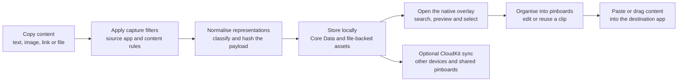
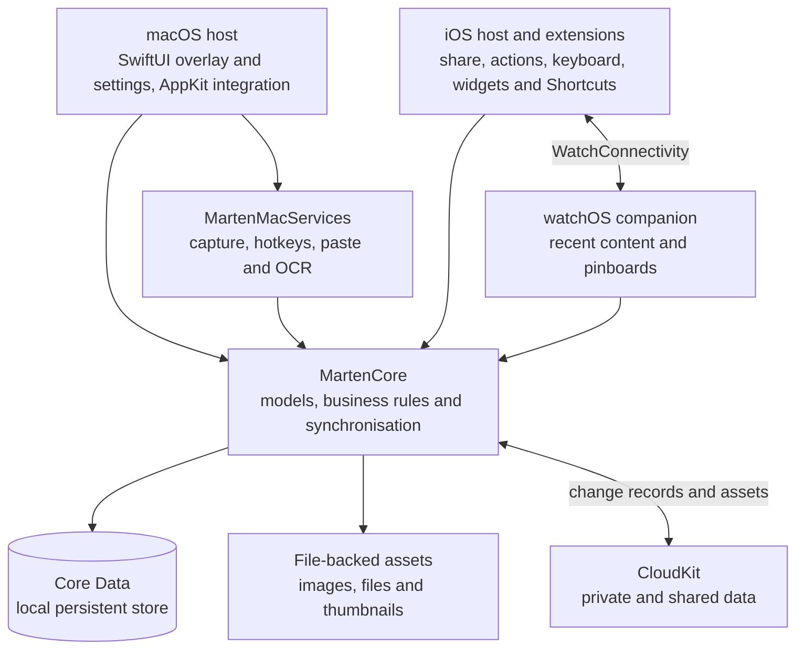

<div align="center">


# Marten

A native clipboard workspace for the Apple ecosystem: remember what you copied, find it instantly,
organise it into pinboards and bring it back to the app where you need it.

[Overview](#overview) · [Demo](#demo) · [Features](#features) · [Workflow](#the-workflow) · [Engineering decisions](#engineering-decisions) · [Architecture](#architecture) · [Development](#development)

</div>

## Overview

Marten was built around a daily problem: useful clipboard content disappeared as soon as something else was copied.
The macOS application kept a searchable history and a keyboard-driven overlay, while pinboards turned frequently
used clips into reusable collections.

The implementation preserved different clipboard representations instead of reducing everything to a string.
Text, rich text, images, files, URLs, code and colours could share the same storage and synchronisation model,
with content-specific cards and editors in the interface.

The project also included an iOS application, share and action extensions, a custom keyboard, widgets, Shortcuts
actions and a watchOS companion. The shared Swift package contained the data model, item operations, asset storage
and CloudKit synchronisation used by the platform hosts.

## Demo

### macOS


<p align="center">
  <a href="docs/demo/native-workflow.mp4"></a>
</p>

| Vertical layout | Compact panel | Rich-text editor |
| :---: | :---: | :---: |
| [](docs/screenshots/macos-vertical-history.jpg) | [](docs/screenshots/macos-compact-search.jpg) | [](docs/screenshots/macos-rich-text-editor.jpg) |

### iOS

<p align="center">
  <a href="docs/demo/ios-workflow.mp4"></a>
</p>

| Library | Quick Add | Search filters | Image editor |
| :---: | :---: | :---: | :---: |
| [](docs/screenshots/ios-home.png) | [](docs/screenshots/ios-quick-add.png) | [](docs/screenshots/ios-filters.png) | [](docs/screenshots/ios-image.png) |

### watchOS

| Pinboards | Clip preview | Move to pinboard |
| :---: | :---: | :---: |
| [](docs/screenshots/watchos-pinboards.png) | [](docs/screenshots/watchos-text-preview.png) | [](docs/screenshots/watchos-move.png) |

## Features

- **A native clipboard workflow.** Menu-bar access, a global shortcut, keyboard navigation, quick-paste actions,
  plain-text pasting and a paste stack connected history browsing to the active application.
- **Content-aware history.** The model retained multiple representations per clip, with dedicated text, rich-text,
  link, image, file, code and colour handling. Source-app metadata and thumbnails supported scanning the history.
- **Reusable pinboards.** Named and coloured collections organised clips around a task or context. Protected
  pinboards used local authentication and a configurable unlock duration.
- **Local persistence and explicit sync.** Core Data stored the local model, while file-backed asset storage kept
  larger payloads outside the relational records. Separate inbound and outbound CloudKit engines handled changes,
  assets, retries, conflict resolution and sharing.
- **Privacy controls inside the product.** Ignored applications, confidential/transient-content filtering,
  configurable history retention and screen-sharing visibility let the user control capture behaviour.
- **Apple platform integrations.** The iOS hosts exposed share/action extensions, keyboard insertion, widgets and
  App Intents. WatchConnectivity connected the phone and watch experiences.
- **Optional system intelligence.** Vision supported screen-region OCR. Foundation Models supplied on-device
  summarising, proofreading, rewriting and shortening when Apple Intelligence was available.

## The workflow



The default macOS shortcut was **Command + Shift + V**. **Command + Shift + O** opened OCR capture, and
**Command + 1–9** were the default quick-paste bindings. Shortcuts could be changed in settings.

## Engineering decisions

| Decision | Why |
| --- | --- |
| Preserve representations alongside an item's semantic type | A rich-text, image or file clip needed more information than its searchable text preview |
| Separate persistence from asset storage | Binary payloads and thumbnails could be managed without expanding every Core Data record |
| Share domain code through `MartenCore` | The platform hosts used the same model, business rules and sync behaviour |
| Keep macOS services separate from the overlay UI | Pasteboard monitoring, hotkeys, paste automation and OCR could be tested and evolved independently |
| Use separate inbound and outbound sync engines | Record mapping, history processing, retries, downloaded assets and conflicts had explicit responsibilities |
| Route private and shared CloudKit data separately | Personal history and shared pinboards used distinct sync paths and permission rules |
| Express capture and paste operations through coordinators and protocols | The app could connect real system services while tests supplied controlled dependencies |
| Check system capabilities before enabling integrations | CloudKit, local authentication, OCR and Apple Intelligence depended on the host's entitlements, permissions and availability |

Implementation: [clipboard monitoring](MartenMac/Sources/MartenMacServices/Services/PasteboardMonitor/),
[item operations](MartenCore/Sources/BusinessRules/), [persistence](MartenCore/Sources/Persistence/) and
[synchronisation](MartenCore/Sources/Sync/).

## Architecture



**Stack:** Swift, SwiftUI, AppKit and UIKit · Core Data, CloudKit, App Groups and WatchConnectivity · Vision,
LocalAuthentication, App Intents, WidgetKit and Foundation Models · Swift Package Manager and Xcode.

### Platform scope

| Platform | Implementation |
| --- | --- |
| **macOS** | Clipboard monitoring, overlay, pinboards, editors, paste workflow, settings and OCR integration |
| **iOS** | Library and editors, shared storage, share/action extensions, custom keyboard, widgets and Shortcuts |
| **watchOS** | Companion views and phone/watch content updates |

The package deployment targets were **macOS 26, iOS 26 and watchOS 26**. CloudKit required a signed host with the
corresponding capabilities and an iCloud account. Apple Intelligence features depended on device and model
availability. iOS used its app and extension entry points rather than macOS-style continuous background capture.

## Development

The Swift packages used local dependencies:

```bash
swift build --package-path MartenCore
swift build --package-path MartenMac
swift run --package-path MartenMac MartenMac
```

The macOS application requested Accessibility and Input Monitoring for its global keyboard and paste workflow.
Screen Recording was an additional permission for OCR capture.

The [development guide](docs/development.md) covers the package targets, Xcode-host setup, capabilities and test
commands.

## Repository layout

| Path | Contents |
| --- | --- |
| [`MartenCore/`](MartenCore/) | Shared model, persistence, item operations, assets, sync and core tests |
| [`MartenMac/`](MartenMac/) | macOS application, native services, overlay, editors, settings and tests |
| [`MartenIOS/`](MartenIOS/) | iOS and watchOS app modules, views, services and integration logic |
| [`MartenMacWrapper/`](MartenMacWrapper/) | Desktop host source, entitlements and app assets |
| [`MartenIOSWrapper/`](MartenIOSWrapper/) | iOS, watchOS, keyboard, share, action and widget host source |
| [`Marten.xcworkspace`](Marten.xcworkspace/) | Workspace references for locally configured Xcode hosts |
| [`docs/`](docs/) | Screenshots, demo recordings and the development guide |

## Author

[Daniil Hirchyts](https://github.com/Daniil-Hirchyts).
