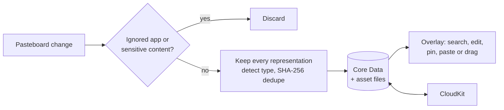
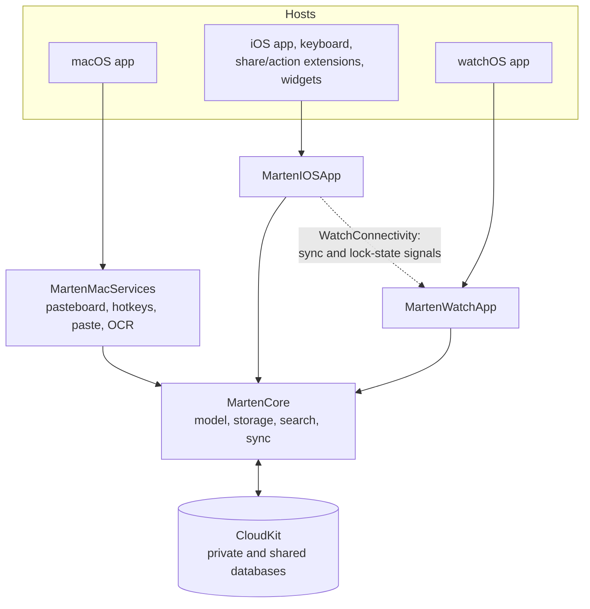

<div align="center">


# Marten

Clipboard history and pinboards for macOS, iOS and watchOS.

</div>

Marten records what you copy on the Mac and keeps it searchable from a keyboard-driven overlay. Clips you
want to keep go into pinboards. History and pinboards sync through iCloud to the iPhone and Apple Watch apps.

Requires macOS 26, iOS 26 or watchOS 26.

## macOS


<p align="center">
  <a href="docs/demo/native-workflow.mp4"></a>
</p>

| Vertical layout | Compact panel | Rich-text editor |
| :---: | :---: | :---: |
| [](docs/screenshots/macos-vertical-history.jpg) | [](docs/screenshots/macos-compact-search.jpg) | [](docs/screenshots/macos-rich-text-editor.jpg) |

- **⌘⇧V** opens the overlay. It docks to any screen edge or opens as a compact panel at the cursor.
- Type to search. Filter by date, content type or source app.
- Paste into the frontmost app, paste as plain text, or drag a clip out. **⌘1–⌘9** paste the first nine
  clips. Select several clips to paste them in order.
- Edit a clip before pasting it, with editors for text, rich text, code, images, colours and links.
- **⌘⇧O** captures text from a screen region using Vision OCR.
- Clips from ignored apps aren't recorded, and neither are private keys, API keys, card numbers or one-time
  codes. History is pruned after a configurable period.
- Pinboards can be locked and opened with Touch ID or the Mac password.

## iOS

<p align="center">
  <a href="docs/demo/ios-workflow.mp4"></a>
</p>

| Library | Quick Add | Search filters | Image editor |
| :---: | :---: | :---: | :---: |
| [](docs/screenshots/ios-home.png) | [](docs/screenshots/ios-quick-add.png) | [](docs/screenshots/ios-filters.png) | [](docs/screenshots/ios-image.png) |

- Tap a clip to copy it. Search, filter and edit work as on the Mac.
- Add clips from the share sheet, the action extension, Shortcuts, or Quick Add (new text, paste, document
  scan).
- The Marten keyboard inserts clips into any text field.
- Widgets show pinboards on the Home Screen and the latest clip on the Lock Screen.
- Pinboards can be shared with other iCloud users.

## watchOS

| Pinboards | Clip preview | Move to pinboard |
| :---: | :---: | :---: |
| [](docs/screenshots/watchos-pinboards.png) | [](docs/screenshots/watchos-text-preview.png) | [](docs/screenshots/watchos-move.png) |

The watch app shows pinboards and their clips. You can preview a clip, move it to another pinboard, or add a
text clip.

## How it works



A clip stores every type the source app wrote to the pasteboard, for example RTF, plain text and a file URL,
so pasting it back keeps the original formatting. Marten also assigns a content type (text, rich text, code,
link, image, file, colour or mixed), which picks the clip's card and editor. A SHA-256 hash of the payload
removes duplicates. Images, files and thumbnails are written to an asset directory next to the Core Data
store rather than into the database.



Each device syncs with CloudKit directly. Separate inbound and outbound engines handle record changes and
assets. For conflicts, pinboard edits go to the latest writer, and a clip keeps its earliest version.
Shared pinboards live in the CloudKit shared database. WatchConnectivity carries no clip data. The phone
uses it to tell the watch that a sync finished, or that a pinboard was locked or unlocked.

Where Apple Intelligence is available, the editors can summarise, proofread, rewrite or shorten text with the
on-device Foundation Models framework.

## Repository layout

| Path | Contents |
| --- | --- |
| [`MartenCore/`](MartenCore/) | Shared Core Data model, asset store, search, item operations, CloudKit sync |
| [`MartenMac/`](MartenMac/) | macOS app UI and `MartenMacServices` (pasteboard monitor, hotkeys, paste engine, OCR) |
| [`MartenIOS/`](MartenIOS/) | `MartenIOSApp` and `MartenWatchApp` modules |
| [`MartenMacWrapper/`](MartenMacWrapper/) | macOS app host: entitlements, Info.plist, icon |
| [`MartenIOSWrapper/`](MartenIOSWrapper/) | iOS, watchOS, keyboard, share, action and widget hosts |

## Building

```bash
swift build --package-path MartenCore
swift run --package-path MartenMac MartenMac
```

The macOS app needs Accessibility and Input Monitoring for the global shortcut and pasting, plus Screen
Recording for OCR. iCloud sync needs a signed host with the CloudKit and App Group capabilities. The Xcode
projects aren't committed; [docs/development.md](docs/development.md) covers setting up the hosts and running
the tests.

## Author

[Daniil Hirchyts](https://github.com/Daniil-Hirchyts)
